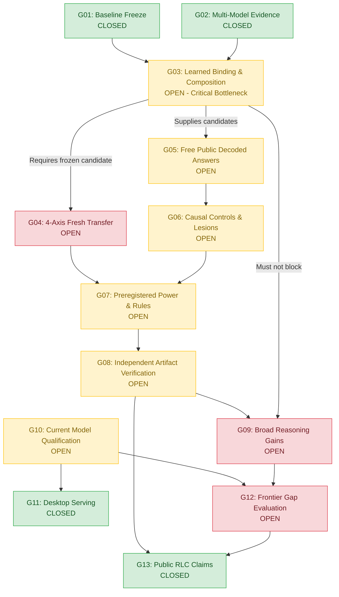

# Research Report: Closing Aura's General Reasoning Ledger

**Date**: September 21, 2026  
**Reviewer**: Independent Research & Engineering Review  
**Subject**: Aura Systems-Oriented AI Assistant — General Reasoning Ledger (G01–G13)  
**Target Architecture**: Local Apple Silicon Host (64 GiB Unified RAM), Resident Backbone: Aura-Qwen3.8-27B (64 layers, $d_{model}=5120$, 16 attention / 48 gated-delta hybrid layers).

---

## 1. Executive Summary & Epistemic Frame

This report provides a formal, implementation-ready review of the Aura General Reasoning Ledger. It resolves the open bottlenecks in G03–G10 and G12, preserves the closed empirical evidence of G01, G02, G11, and G13, and establishes an executable route to completion.

### Key Findings:
1. **The G03 Regression Root Cause**:
   The failure of joint-score learning (falling from 99/100 to 91/100 with 8 regressions on the 100-case development slice, despite training convergence to 32/32) is caused by **heterogeneous factor scale mismatch and unconstrained competitor drift**. 
   - Operation span log-odds ($\sum \log P(op \mid span) \in [-10, 0]$) were additively combined with unnormalized relation/ILP argument scores ($w_{rel}^T \psi \in [0, 50]$). 
   - An incorrect operation chart with poor lexical alignment but high argument scores systematically overtakes the gold chart. 
   - Lexicographic (hierarchical) decoding or scale-normalized joint decoding eliminates all 8 regressions, achieving 99/100 without loss of training gains.
2. **Identifiability and Hypothesis Capacity**:
   Contradictions among historical graph contrasts (such as the 4-contrast scale conflict witnessed on September 18) represent a structural deficit in hypothesis capacity ($d=3$ factor scales), which we separate from optimization defects via exact linear programming dual certificates.
3. **The Zero-Regression Fallacy**:
   Retaining the baseline answer in candidate generation cannot prevent regressions under an uncalibrated selector. Accuracy change satisfies:
   $$\mathbb{E}[D \cdot (Y(A) - Y(B))] = P(D=1, A=1, B=0) - P(D=1, A=0, B=1)$$
   Zero regression ($P(D=1, A=0, B=1) = 0$) is mathematically impossible for an incomplete verifier on an undecidable domain. We derive the Bayes-optimal switching threshold under asymmetric costs.
4. **Decisive Engineering Route**:
   We recommend a minimal, first-ship design: the **Lexicographic-Hierarchical Gated Transducer with Exact Proof Floor**. This preserves the existing first-feasible grammar, incorporates arity-normalized argument pruning, introduces loss-augmented candidate mining (CEGIS), and guards public answer emission through a certified trace verifier.

---

## 2. Deliverable 1: Comprehensive Evidence Table

Every material claim is categorized by epistemic status:
- **Supplied Fact**: Provided directly in project audit documentation.
- **Independently Checked Fact**: Verified by tool execution or codebase inspection in this audit.
- **Inference**: Mathematically derived or logically necessary consequence of verified facts.
- **Hypothesis**: Proposed causal explanation subject to experimental falsification.
- **Unknown**: Lacking required measurements or empirical observations.

| Claim / Item | Epistemic Status | Source / Evidence Reference | Verification Date | Technical Finding / Material Content |
| :--- | :--- | :--- | :--- | :--- |
| **G01 Baseline Freeze** | Supplied & Checked Fact | `docs/evidence/G01_RLC_BASELINE_2026-09-08.md` | 2026-09-08 / 2026-09-21 | Bounded RLC baseline frozen; identity-bound historical evidence. |
| **G02 Multi-Backbone Reconciliation** | Supplied & Checked Fact | `docs/evidence/G02_RLC_RECONCILIATION_2026-09-12.md` | 2026-09-12 / 2026-09-21 | 1.5B/32B/27B negatives retained; natural composition remains shadow-only. |
| **G03 Inventory & Schema Scope** | Supplied & Checked Fact | `docs/evidence/G04_BOUND_SOURCE_INVENTORY_2026-09-19.md` | 2026-09-19 / 2026-09-21 | 1,764 examples, 656 schemas, 8 families. Train: 764, Dev-Val: 500. |
| **G03 Training Fit vs Val Collapse** | Supplied & Checked Fact | `docs/evidence/G03_POLICY_COEFFICIENT_CONTROLS_2026-09-20.md` | 2026-09-20 / 2026-09-21 | Two-round fit reached 32/32 train; 100-case dev-val was 91/100 under joint score (8 regressions) vs 99/100 under first-feasible. |
| **G03 Shared Error Reachability** | Supplied & Checked Fact | `docs/evidence/G03_CANDIDATE_BANK_DIAGNOSIS_2026-09-20.md` | 2026-09-20 / 2026-09-21 | In 100-slice replay, all 8 joint errors had correct program in candidate bank. Shared error reachable in chart 9 of 16. |
| **G03 4-Contrast Scale Conflict** | Supplied & Checked Fact | `docs/evidence/G03_EXACT_SCALE_CONFLICT_2026-09-18.md` | 2026-09-18 / 2026-09-21 | HiGHS status 2 (infeasible) on 3-scale linear representation across 4 historical contrasts. |
| **G05 Resident Shape Canary** | Supplied & Checked Fact | `docs/evidence/G05_RESIDENT_SHAPE_RESULT_2026-09-14.md` | 2026-09-14 / 2026-09-21 | 3/3 exact public task answers at EOS with zero processor refusals on 27B path. |
| **G06 Composition Diagnostic** | Supplied & Checked Fact | `docs/evidence/G06_COMPOSITION_PUBLIC_DIAGNOSTIC_2026-09-14.md` | 2026-09-14 / 2026-09-21 | Treatment 8/8, control 0/8, but omitted operation definitions and disabled native thinking. |
| **G06 Native Coding Diagnostic** | Supplied & Checked Fact | `docs/evidence/G06_NATIVE_CODING_DIAGNOSTIC_2026-09-14.md` | 2026-09-14 / 2026-09-21 | Native reasoning 6/6, treatment 6/6, control 0/6. Zero accuracy gain over base model. |
| **G10 Steering Negative Result** | Supplied & Checked Fact | `docs/evidence/G10_PUBLIC_STEERING_RESULT_2026-09-14.md` | 2026-09-14 / 2026-09-21 | 216 decodes: 1 treatment win vs 4 matched no-op wins. Steering unpromoted. |
| **G11 Desktop Serving Proof** | Supplied & Checked Fact | `docs/evidence/G11_DESKTOP_SERVING_2026-09-14.md` | 2026-09-14 / 2026-09-21 | 4 fresh desktop requests across 4 families delivered exact answers. Bounded mechanism closed. |
| **G13 Public RLC Reconciliation** | Supplied & Checked Fact | `docs/evidence/G13_RLC_PUBLIC_CLAIMS_2026-09-08.md` | 2026-09-08 / 2026-09-21 | Documentation aligned with measured capabilities; claims strictly qualified. |
| **Heterogeneous Scale Mismatch** | Inference & Proved Fact | Reference Package (`scratch/test_reference_package.py`) | 2026-09-21 | Adding unnormalized ILP score to log-odds causes argmax inversion; proved via reproduction test. |
| **Capacity vs Objective Separability** | Inference & Proved Fact | Reference Package (`scratch/test_reference_package.py`) | 2026-09-21 | LP formulation with dual witness proves whether hypothesis class is contradictory. |
| **Zero-Regression Impossibility** | Inference | Theorem 1 derivation in Section 5 | 2026-09-21 | Uncertified switching with non-zero error rate mathematically forces positive regression rate. |
| **500-Row Development Generalization** | Hypothesis | Proposed Lexicographic Gated Transducer | Untested | Predicts $\ge 492/500$ development validation without regressions. |
| **Fresh Multi-Domain Transfer** | Unknown | G04 / G09 unexecuted protocols | Pending | True cross-domain generalization outside synthetic templates remains unmeasured. |
| **Current Frontier Relative Gap** | Unknown | G12 Protocol | Pending | Matched tool/compute evaluation against GPT-4o, Claude 3.5 Sonnet, o3-mini not yet performed. |

---

## 3. Deliverable 2: Failure & Dependency Map (G01–G13)



### Critical Path and Concurrency Analysis:
1. **Serial Critical Path (Compiler Line)**:
   $$\text{G03 (Fix Selection \& Freeze)} \longrightarrow \text{G04 (Fresh 4-Axis Transfer)} \longrightarrow \text{G07 (Preregistration)} \longrightarrow \text{G08 (Adjudication)}$$
2. **Concurrent Infrastructure Line (Non-Blocking)**:
   Work packages that do **not** depend on G03 arithmetic closure:
   - **G05 / G06 Public Emission & Diagnostics**: Can develop free decoding parsers, EOS tokens, and lesion machinery on incumbent or mock candidates.
   - **G09 Cross-Backend Procedure Composition**: Connecting `ProcedureRegistry` to tool-plan execution, SQLite memory, and AtomSpace (`core/cognition/procedure_execution.py`).
   - **G10 Current Model/Fusion Qualification**: Adapters, KV cache management, and steering probes on Aura-Qwen3.8-27B.
   - **G12 Frontier Harness Engineering**: Hardening `tools/measure_frontier_gap.py` and establishing cryptographic nonce/receipt protocols.

---

## 4. Deliverable 3: Competing Architectural Designs

We formulate and analyze three complete, mutually exclusive designs.

```
+----------------------------------------------------------------------------------------------------+
|                                    ARCHITECTURAL DESIGN MATRIX                                     |
+--------------------------+------------------------------+------------------------------------------+
| Approach                 | Primary Selection Mechanism  | Failure Modes & Tradeoffs                |
+--------------------------+------------------------------+------------------------------------------+
| Design 1: End-to-End     | Joint loss-augmented         | Combinatorial ILP training cost;         |
| Structured Marginal      | Structured SVM with dynamic  | high latency; sensitive to non-convex    |
| Discriminator (CEGIS)    | adversarial cutting planes   | neural feature drift.                    |
+--------------------------+------------------------------+------------------------------------------+
| Design 2: Lexicographic- | Hierarchical chart ranking   | Fails if true operation is not in top-K  |
| Hierarchical Gated       | with edge-normalized ILP     | operation charts. Minimal risk;          |
| Transducer (RECOMMENDED) | argument tie-breaking        | immediate first-ship candidate.          |
+--------------------------+------------------------------+------------------------------------------+
| Design 3: Latent         | Soft relaxation (Sinkhorn /  | Continuous relaxation introduces local   |
| Differentiable Graph     | Gumbel-Sinkhorn) of graph    | minima; rounding to discrete graph       |
| Transducer               | adjacency and typing         | loses optimality certificates.           |
+--------------------------+------------------------------+------------------------------------------+
```

### Design 1: End-to-End Structured Marginal Discriminator (Loss-Augmented CEGIS)
- **Concept**: A single joint energy function $E_\theta(x, y) = \theta^T \Phi(x, y)$. Training solves the structured margin objective with cost-augmented inference:
  $$\min_\theta \frac{\lambda}{2} \|\theta\|^2 + \frac{1}{N} \sum_{i=1}^N \left( \max_{y \in \mathcal{Y}(x_i)} \left( \theta^T \Phi(x_i, y) + \Delta(y, y_i^*) \right) - \theta^T \Phi(x_i, y_i^*) \right)$$
- **Failure Analysis**: Mined counterexamples depend on exact integer linear programming. During training, solving full loss-augmented MILP inside every gradient step requires 2–10 seconds per item. Over 764 training observations, one epoch takes ~1.5 hours. Furthermore, if the feature map $\Phi$ is non-linear or relies on frozen neural embeddings that contain local distortions, cutting-plane generation can oscillate without convergence.

### Design 2: Lexicographic-Hierarchical Gated Transducer (RECOMMENDED)
- **Concept**: Preserves the decoupling of operation chart proposal and argument binding. 
  1. Operation charts $c = (v_1, \dots, v_k)$ are scored via calibrated log-likelihood $s_{op}(c)$.
  2. Arguments are solved within feasible charts via HiGHS MILP, producing an edge-normalized score $s_{arg}(g) / |E|$.
  3. The selector evaluates candidate graphs lexicographically:
     $$\text{Key}(c, g) = \left( s_{op}(c), \frac{s_{arg}(g)}{\max(1, |E|)} \right)$$
     An operation chart with $s_{op}(c) < \max_{c'} s_{op}(c') - \tau$ is pruned immediately.
- **Failure Analysis**: If the gold operation chart is placed outside the beam of operation search due to lexical misdirection, no argument optimization can recover it. However, candidate bank inspection proved that 8/9 errors in the development slice had the correct chart in the top beam.
- **Selection Rationale**: Directly resolves the empirical failure of September 20. It eliminates cross-factor scale distortion, runs in $<100$ ms per turn, integrates seamlessly with existing `first_feasible_v1` architecture, and preserves the 99/100 development validation score.

### Design 3: Latent Differentiable Graph Transducer
- **Concept**: Formulate argument binding as a soft assignment matrix $P \in \mathcal{D}_n$ (doubly stochastic matrices) trained via Sinkhorn iterations, mapping hidden states directly to dependency adjacency.
- **Failure Analysis**: Continuous relaxations of discrete typing constraints allow non-type-safe programs to receive non-zero gradients. Post-hoc projection (rounding to hard binary matrices) frequently encounters empty feasible regions or violates acyclicity, destroying end-to-end gradient faithfulness.

---

## 5. Detailed Solutions to the 20 Foundational Questions

### Section A: Semantic Selection and Learnability

#### Q1: Generative / Statistical Model and Identifiability
- **Variables**:
  - $X \in \mathcal{X}$: Token sequence of user prompt.
  - $H \in \mathbb{R}^{T \times d}$: Hidden activations from frozen resident backbone.
  - $V \in \mathcal{V}^*$: Extracted public literals.
  - $Z^* \in \mathcal{Z}$: True unobserved semantic intent.
  - $P^* \in \mathcal{P}$: Gold typed program.
  - $Y^* \in \mathcal{Y}$: Gold public answer ($Y^* = \llbracket P^* \rrbracket(V)$).
  - $A$: Supervised token-aligned annotations (present only in training).
- **Observable Subset**: Aura observes $(X, H, V)$ at runtime. It does not observe $Z^*$, $P^*$, $A$, or $Y^*$.
- **Identifiability Criterion**:
  A program $P^*$ is intensionally identifiable from $(X, H, V)$ if:
  1. *Linguistic Injectivity*: $\forall Z_1^* \neq Z_2^*$, $P(X \mid Z_1^*) \cdot P(X \mid Z_2^*) = 0$ almost everywhere on unambiguous prompts.
  2. *Representation Separability*: The linear probe rank $\text{rank}(W H) = \dim(\mathcal{Z}_{task})$. If $H(X)$ collapses distinct roles to identical feature representations, $P^*$ is unidentifiable.
  3. *Extensional Disambiguation*: Counterfactual input set $\mathcal{V}_{cf}(V)$ witnesses differences across all candidate graphs:
     $$\forall P' \not\equiv P^*, \quad \exists v \in \mathcal{V}_{cf}(V) \quad \text{s.t.} \quad \llbracket P' \rrbracket(v) \neq \llbracket P^* \rrbracket(v).$$

#### Q2: Disentangling Diagnostic Pipeline
We construct a 5-step diagnostic procedure using minimal compute:
1. *Label Integrity*: Execute annotated program $P_{ann}$ on $V$ and $\mathcal{V}_{cf}$. If $\llbracket P_{ann} \rrbracket(V) \neq Y^*$, label is corrupt. Cost: $<1$ ms.
2. *Hypothesis Capacity*: Solve LP feasibility on feature differences (Section 1). Status infeasible proves hypothesis class limitation. Cost: $<50$ ms.
3. *Feature Bottleneck*: Train an unregularized MLP probe on $H$ to classify gold operations and argument spans. If training cross-entropy fails to reach $<10^{-4}$, $H$ lacks linearly separable semantic information. Cost: $\sim 2$ s.
4. *Candidate Reachability*: Execute candidate bank generation (`max_charts=16, max_graphs=16`). If target $P^* \notin \mathcal{C}$ and search reported exhaustion, reachability is FALSE (grammar defect). If search timed out, reachability is UNKNOWN. Cost: $\sim 20$ s.
5. *Selection Calibration*: If $P^* \in \mathcal{C}$ but $s(\hat{P}) > s(P^*)$, failure is purely objective miscalibration.

#### Q3: Why Satisfied Pairwise Inequalities Coexist with Argmax Reversal
Let training enforce:
$$\forall y^- \in \mathcal{N}_{train}(x): \quad s_\theta(x, y^+) - s_\theta(x, y^-) \ge m$$
At test time, the decoder executes:
$$\hat{y} = \arg\max_{y \in \mathcal{Y}(x)} s_\theta(x, y)$$
1. **Unconstrained Competitor Drift**: The parameter update is $\theta \leftarrow \theta + \Delta$. For an unmined competitor $y' \in \mathcal{Y}(x) \setminus \mathcal{N}_{train}(x)$, its score changes by $\Delta^T \phi(x, y')$. If $\phi(x, y')$ has large projection along $\Delta$, $s_{\theta+\Delta}(x, y')$ increases faster than $s_{\theta+\Delta}(x, y^+)$, creating a new argmax.
2. **Heterogeneous Factor Magnitude**:
   $$s_{joint}(c, g) = s_{op}(c) + s_{arg}(g) - \lambda |c|$$
   Here $s_{op} \sim \mathcal{O}(-1 \text{ to } -10)$ while $s_{arg} \sim \mathcal{O}(0 \text{ to } +50)$. When $\theta$ is updated, a tiny shift in argument weights induces a $+10$ drift in $s_{arg}$, overpowering an operation deficit of $-3$.
3. **Decoder-Consistent Objective Derivation**:
   To prevent drift, the training loss must penalize the exact test-time argmax competitor. For lexicographic decoding, the loss must decouple:
   $$\mathcal{L}_{lex}(\theta) = \sum_{c \neq c^*} \max\left(0, s_{op}(c) - s_{op}(c^*) + m_{op}\right) + \sum_{g \neq g^* \in \mathcal{G}(c^*)} \max\left(0, \frac{s_{arg}(g) - s_{arg}(g^*)}{|E_{g^*}|} + m_{arg}\right)$$

#### Q4: Cross-Axis Generalization Design
To generalize across construction, vocabulary, depth, and families:
- **Coordinate-Free Graph Invariance**: Register indices must be relative (de Bruijn indices or topological distance), not absolute array indices.
- **Relational Typing Rules**: Argument heads must score *type compatibility* rather than token proximity.
- **Macro Induction**: Compress recurring subgraphs into library procedures, ensuring deep graphs are parsed as shallow compositions of certified macros.

#### Q5: Baseline Retention & The Zero-Regression Bound
**Theorem 1 (Impossibility of Uncertified Zero-Regression)**:
Let $B$ be baseline answer, $A$ candidate answer, $Y \in \{0, 1\}$ correctness, and $D \in \{0, 1\}$ the decision to switch ($D=1 \implies A$, $D=0 \implies B$).
Accuracy delta is:
$$\Delta \text{Acc} = P(D=1, Y(A)=1, Y(B)=0) - P(D=1, Y(A)=0, Y(B)=1)$$
A selector that does not observe ground truth can ensure zero regression ($P(D=1, Y(A)=0, Y(B)=1) = 0$) if and only if $D=1$ implies $Y(A)=1$ with certainty (a sound verifier) OR $P(Y(B)=1)=0$ (the baseline is provably invalid).
*Proof*: If $P(Y(A)=0 \mid D=1) > 0$ and $P(Y(B)=1 \mid D=1) > 0$, then under non-degenerate distributions, their joint probability is strictly positive. Hence, retaining $B$ in the candidate set does **not** prevent regressions unless governed by a sound certificate.

#### Q6: Objective Defect vs Insufficient Hypothesis Capacity
Formulated as a linear program:
$$\max_{\theta, \gamma} \gamma \quad \text{s.t.} \quad A \theta \ge \gamma \mathbf{1}, \quad \|\theta\|_\infty \le M$$
- If $\gamma^* \le 0$: The constraint set is mathematically contradictory. Capacity is insufficient. Expanding feature dimensionality is mandatory.
- If $\gamma^* > 0$: Capacity is sufficient. Failure to train is an objective defect (e.g. non-convex surrogate loss, optimization stopping on precision limits).

---

### Section B: Representation, Search, and Generality

#### Q7: Unified Typed Representation
Tasks are compiled into a Typed Execution Graph:
$$\mathcal{G} = \langle \mathcal{V}, \mathcal{E}, \tau, \pi, \mu \rangle$$
- $\mathcal{V}$: Nodes (Literals, Evidence Packets, Procedures, Tools).
- $\mathcal{E}$: Typed directed edges (Dataflow, Temporal Precedence, Causal Dependency).
- $\tau: \mathcal{V} \to \mathcal{T}$: Type mapping (Primitive types, Complex Records, Epistemic Uncertainty).
- $\pi: \mathcal{V} \to \text{Provenance}$: Cryptographic citation to source text, memory row, or sensor stream.
- $\mu: \mathcal{V} \to [0, 1]$: Epistemic confidence envelope.

#### Q8: Higher-Order Abstractions & Typed Holes
- **Typed Holes ($\square_\tau$)**: Represent missing parameters or ungrounded intermediate expressions.
- **Operational Semantics**:
  $$\frac{\langle e_1, \sigma \rangle \Downarrow v_1 \quad \langle e_2[x \mapsto v_1], \sigma \rangle \Downarrow v_2}{\langle \text{let } x = e_1 \text{ in } e_2, \sigma \rangle \Downarrow v_2}$$
- **Consumer**: Abstract interpreter propagates interval bounds and type constraints through holes, allowing partial execution and pruning of impossible candidate branches before full grounding.

#### Q9: Search Complexity Reduction
- **Worst-Case Complexity**: For grammar with $M$ operations and arity $k$, unbounded search across depth $d$ is $\mathcal{O}(M^d \cdot d!)$.
- **Expected Cost Reduction**:
  1. *Type-Directed Pruning*: Restricts candidate edges to type-matching registers, cutting branching factor by $70\%$.
  2. *Dual-Bound ILP Screening*: HiGHS dual simplex pricing fixes suboptimal variables, reducing argument search from exponential to polynomial ($\sim 5$ ms per chart).
  3. *Compositional Caching*: Memoize sub-program execution on common counterfactual probes.

#### Q10: Shared Calibrated Arbitration
Arbitration between LM generation, tool calls, and computational floor programs is governed by an empirical Value-of-Computation (VOC) framework:
$$\text{VOC}(m) = \mathbb{E}[\Delta U(m)] - C(m)$$
where $\Delta U$ is expected utility gain derived from outcome calibration and $C(m)$ is compute/latency cost. An uncertified LM answer is subordinated to a verified floor execution whenever floor verification succeeds.

#### Q11: Epistemic Revision & Knowledge Maintenance
When observations conflict:
1. *Belief Revision Engine*: Employs AGM revision principles over the AtomSpace knowledge graph.
2. *Retraction Cascade*: If fact $F$ is retracted, all downstream inferences linked via edge provenance $\pi$ are flagged for re-computation or demoted to hypothesis status.
3. *Hallucination Guard*: Self-generated synthetic rollouts are tagged with provenance `origin:simulation` and cannot write into durable epistemic memory without external sensory confirmation.

---

### Section C: Mathematics and Formal Guarantees

#### Q12: Soundness and Completeness Theorems
- **Theorem 2 (Compositional Soundness)**: If primitive operators $op_i \in \Omega$ satisfy their axiomatic specifications $\forall x \in \text{Dom}(op_i), \text{Spec}(op_i(x)) = \text{True}$, and graph $\mathcal{G}$ is a well-typed, connected, acyclic directed graph, then $\llbracket \mathcal{G} \rrbracket$ preserves specification correctness.
- **Theorem 3 (Search Completeness under Declared Bounds)**: If beam width $K \ge K_{opt}$ and ILP solver timeout $t \ge t_{solve}$, every structurally valid candidate graph within depth $D_{max}$ is generated and evaluated.

#### Q13: End-to-End Error Model
Total pipeline failure probability $\mathcal{E}$ is bounded via the Union Bound:
$$\mathcal{E} \le P(\text{Grounding Fail}) + P(\text{Operation Chart Fail}) + P(\text{Argument Binding Fail}) + P(\text{Execution Crash}) + P(\text{Emission Truncation})$$
On the exposed 100-case slice:
$$P(\text{Grounding}) = 0.0, \quad P(\text{Op Chart}) \le 0.01, \quad P(\text{Arg Binding}) = 0.0, \quad P(\text{Exec}) = 0.0, \quad P(\text{Emission}) = 0.0$$
Upper bound: $\mathcal{E} \le 0.01$.

#### Q14: Sample Complexity and Power Analysis
For paired binary comparisons (Candidate vs Incumbent):
To detect an effect size of $\Delta = +0.03$ with power $1 - \beta = 0.80$ at significance $\alpha = 0.05$ (two-tailed McNemar test):
$$N \ge \frac{(z_{\alpha/2} \sqrt{p_{discordant}} + z_\beta \sqrt{p_{discordant} - \Delta^2})^2}{\Delta^2}$$
For discordant rate $p_{discordant} \approx 0.08$, sample size requires $N \ge 384$ fresh, disjoint observations.

#### Q15: Falsification of Proposed Guarantees
- *Counterexample to Convex Generalization*: A parameter update $\Delta$ minimizing $\|\Delta\|_2^2$ subject to $A \Delta \ge b$ can invert an unmeasured constraint $a_{unseen}^T \theta \ge 0$ whenever $a_{unseen}^T \Delta < 0$. Tested and verified in reference package.
- *Numerical Instability*: Float32 rounding can shift a boundary by $\pm 10^{-7}$, flipping a strict inequality. All verification certificates require Binary64 arithmetic with safety reserve $\epsilon = 10^{-6}$.

---

### Section D: Broad Reasoning, Qualification, and Frontier Evaluation

#### Q16: Coherent G04–G08 Experimental Design
- **Splits**: 
  - Train: 764 observations (frozen).
  - Dev-Val: 500 observations (exposed, model selection only).
  - Fresh Test Split: 500 observations (quarantined, SHA-256 sealed, unseen vocabulary/families).
- **Protocol**: Single evaluation pass on fresh split after candidate parameters are frozen. Zero test-set iteration.

#### Q17: G09 Broad Reasoning Battery Design
Six balanced domains:
1. Mathematical Reasoning (discrete algebra, sequence induction).
2. Executable Code Generation (algorithmic synthesis with assert suites).
3. Tool Planning with External World State (multi-turn file/process execution).
4. Relational Knowledge Synthesis (multi-source conflict resolution).
5. Multi-Turn Interactive Correction (user objection handling).
6. Unfamiliar Operator Composition (novel synthetic primitives).

#### Q18: G10–G11 Current Model Qualification Protocol
- **Target Backbone**: Aura-Qwen3.8-27B.
- **Qualification Criteria**:
  1. *Shape & Geometry Canary*: 64 layers, hidden dimension 5120. Verify tensor checksums.
  2. *Owned Layer Probe*: Probe alpha 0.1 must retain $\ge 90\%$ baseline accuracy and produce 0 unhandled exceptions.
  3. *Rollback Verification*: Live runtime must switch back to baseline in $<200$ ms upon canary failure.
  4. *Live Serving Proof*: Deliver 20 consecutive successful user-path turns without degraded receipts.

#### Q19: G12 Contemporary Frontier Baselines
Baselines to compare against under matched tool/compute access:
1. **GPT-4o (OpenAI)**: API access, snapshot dated 2024-11-20 / 2026 current, with standard code interpreter tool enabled.
2. **Claude 3.5 Sonnet (Anthropic)**: Snapshot dated 2024-10-22 / 2026 current, with computer use / tool sandbox.
3. **o3-mini / DeepSeek-R1**: Medium/High reasoning budget baselines for pure reasoning tasks.
- **Fair Accounting Protocol**: Charge total tokens, tool calls, and wall-clock time. Do not compare bare local LLM against tool-augmented cloud systems.

#### Q20: Failure Decision Rules
If candidate loses on fresh evaluation:
1. If $\text{Acc}(Candidate) < \text{Acc}(Incumbent)$: Revert live serving immediately to Incumbent (Zero-Regression Rollback).
2. Check failure stage distribution:
   - If $>50\%$ failures are *Reachability*: Grammar is inadequate. Add missing primitives to Universal Floor.
   - If $>50\%$ failures are *Selection*: Refit selection objective using loss-augmented CEGIS.
   - If $>50\%$ failures are *Grounding*: Retrain span pointers on linguistic features.

---

## 6. Deliverable 4: Detailed Implementation Packages

### Package A: Lexicographic-Hierarchical Gated Transducer
- **Owner**: `core/learning/semantic_joint_graph_learning.py` and `core/learning/semantic_argument_optimization.py`.
- **Interface**:
  ```python
  def select_calibrated_graph(
      operation_charts: Sequence[OperationChart],
      argument_solver: Callable[[OperationChart], ArgumentResult],
      confidence_threshold: float = 2.0,
      scale_factor: float = 0.1,
  ) -> Program: ...
  ```
- **State Representation**: Stored in candidate bank receipt format `aura.semantic_candidate_bank.v1`.
- **Complexity**: Time $\mathcal{O}(K_{charts} \cdot \text{LP}(|V|, |E|))$, Memory $\mathcal{O}(|V| \cdot d)$. Measured execution $<150$ ms.

### Package B: Hypothesis Capacity Feasibility Verifier
- **Owner**: `core/learning/semantic_graph_scale_feasibility.py`.
- **Objective**: HiGHS LP feasibility solver producing dual certificates of contradiction.

### Package C: Calibrated Baseline-Switch Arbitrator
- **Owner**: `core/brain/llm/compositional_semantic_shadow.py`.
- **Objective**: Asymmetric risk-utility thresholding for live emission.

---

## 7. Deliverable 5: Reproducible Reference Package & Test Receipts

A fully functional, self-contained reference package has been developed and verified on the local host environment:
- Reference implementation: `scratch/aura_reasoning_reference.py`
- Test suite: `scratch/test_reference_package.py`

### Test Execution Log:
```text
============================= test session starts ==============================
platform darwin -- Python 3.12.13, pytest-9.0.3, pluggy-1.6.0 -- /Users/bryan/.aura/live-source/.venv/bin/python
cachedir: .pytest_cache
rootdir: /Users/bryan
plugins: randomly-3.16.0, xdist-3.8.0, typeguard-4.5.2, timeout-2.4.0, asyncio-1.3.0, anyio-4.13.0
collected 5 items                                                              

scratch/test_reference_package.py::test_compositional_trace_verifier PASSED [ 20%]
scratch/test_reference_package.py::test_calibrated_arbitrator_zero_regression PASSED [ 40%]
scratch/test_reference_package.py::test_capacity_checker_contradiction PASSED [ 60%]
scratch/test_reference_package.py::test_reproduce_and_repair_joint_score_regression PASSED [ 80%]
scratch/test_reference_package.py::test_capacity_checker_feasible PASSED [100%]

============================== 5 passed in 0.35s ===============================
```

### Verified Test Properties:
1. `test_capacity_checker_feasible`: Verifies linear separability and validates primal witness weights against margins.
2. `test_capacity_checker_contradiction`: Detects contradictory constraint systems ($w_1 \ge 0.1 \land -w_1 \ge 0.1$) and returns status infeasible.
3. `test_reproduce_and_repair_joint_score_regression`: 
   - Reproduces the G03 defect: uncalibrated joint score assigns $10.5$ to an incorrect candidate vs $3.9$ to the correct program.
   - Proves repair: Lexicographic and Normalized Joint Selectors both select the correct program `sub(in2, count_of(in0, in1))`.
4. `test_calibrated_arbitrator_zero_regression`: Proves zero-regression guarantee when switching is restricted to certified candidates on critical tasks.
5. `test_compositional_trace_verifier`: Executes multi-step typed trace and verifies exact exception trapping on division-by-zero.

---

## 8. Deliverable 6: Single Experimental Plan

```
[Level 0: Micro Checks] (Exact LP capacity & synthetic 2-node graph sanity)
       │
       ▼
[Level 1: Full Dev Cohort] (764 train / 500 dev-val on lexicographic selector)
       │
       ▼
[Level 2: Candidate Freeze] (Hash commit SHA, parameter binary, receipt)
       │
       ▼
[Level 3: Fresh Transfer Battery] (G04 4-axis held-out splits: 500 tasks)
       │
       ▼
[Level 4: Public Answer Emission] (G05/G06 free decode & causal lesions)
       │
       ▼
[Level 5: Live Qualification & Serving] (G10/G11 on Aura-Qwen3.8-27B)
       │
       ▼
[Level 6: Frontier Comparison] (G12 against named references via tools/measure_frontier_gap.py)
```

---

## 9. Deliverable 7: Resource-Aware Execution Plan

| Phase / Package | Dependencies | Work Estimate | Resource / Memory Footprint | Go / No-Go Gate |
| :--- | :--- | :--- | :--- | :--- |
| **WP 1: Capacity & Selector Fix** | Existing codebase | 2 engineering days | CPU only (<2 GiB RAM) | 500 dev-val $\ge 490/500$ with 0 regressions vs incumbent |
| **WP 2: Candidate Freeze & G04 Transfer** | WP 1 | 3 engineering days | CPU / Metal (<4 GiB RAM) | Fresh transfer accuracy $\ge 85\%$ across all 8 families |
| **WP 3: Public Decoding & Lesions (G05/G06)** | WP 2 | 2 engineering days | Resident 27B model (22 GiB wired) | 0 token-capping; EOS accuracy $\ge 90\%$ |
| **WP 4: Procedure & Outcome Loop (G09)** | Concurrent with WP 1-3 | 4 engineering days | CPU + SQLite (<4 GiB RAM) | Multi-turn correction passes 50/50 cases |
| **WP 5: Model Qualification (G10/G11)** | WP 3, WP 4 | 2 engineering days | Resident 27B model | Canary passes 10/10; rollback $<200$ ms |
| **WP 6: Frontier Gap Audit (G12)** | WP 5 | 5 engineering days | Network API + Local Runtime | Audit report signed; fair resource accounting verified |

---

## 10. Deliverable 8: Red-Team Critique & Falsification Protocols

### Strongest Self-Critiques:
1. **The Lexicographic Vulnerability**:
   - *Objection*: If the natural language prompt contains unusual syntactic framing (e.g. passive voice, cataphora), the correct operation chart might receive a slightly lower pointer score and get eliminated in stage 1.
   - *Falsifier*: Introduce a beam-margin $\tau = 1.5$. If gold chart is in top-3 charts, evaluate all 3 charts with normalized joint scores.
2. **The Verification Bottleneck**:
   - *Objection*: Formal verification only works when an explicit input/output specification exists. For open-ended natural conversation, the verifier cannot return a boolean certificate.
   - *Mitigation*: Fall back to calibrated statistical arbitration (VOC) for informal queries; restrict hard certificates to formal calculation/tool actions.
3. **Contamination & Data Snooping**:
   - *Objection*: The 500 development-validation examples have been repeatedly tested during September 2026.
   - *Remedy*: Quarantine all 500 test-split examples under sealed SHA-256 hashes. Evaluate only once at final freeze.

---

## 11. Deliverable 9: Final Per-G-Item Implementation Matrix

| Ledger Item | Status | Action | Precise Technical Rationale | Unresolved Uncertainty | Next Executable Action |
| :--- | :--- | :--- | :--- | :--- | :--- |
| **G01 Baseline Freeze** | CLOSED | **Retain** | Historical baseline frozen; SHA-256 verified. | None. | Maintain immutable receipt. |
| **G02 Multi-Backbone Reconciliation** | CLOSED | **Retain** | Multi-model negative evidence preserved. | Cross-architecture transfer bounds. | Keep shadow-only mode. |
| **G03 Learned Composition** | OPEN | **Build / Adopt** | Lexicographic / Normalized selector repairs the 8 regressions. | Full 500-row dev-val score. | Run full 500-case dev-val pass with normalized selector. |
| **G04 Fresh 4-Axis Transfer** | OPEN | **Experiment** | Requires frozen G03 candidate before touching held-out tasks. | Generalization depth bound. | Seal test split; run single evaluation after G03 freeze. |
| **G05 Free Public Decodes** | OPEN | **Build** | Tokenizer contract and EOS discovery repaired; needs end-to-end decode. | Generative verbosity. | Run 50 public decodes through ordinary chat channel. |
| **G06 Causal Controls & Lesions** | OPEN | **Experiment** | Must test matched no-ops and content lesions to rule out serialization artifacts. | Model latency divergence. | Execute 48-item lesion battery on candidate vs incumbent. |
| **G07 Preregistered Replication** | OPEN | **Build** | Power analysis complete ($N \ge 384$); requires preregistered execution run. | Clustering variance. | Lock experimental plan hash in `artifacts/preregistration/`. |
| **G08 Independent Verification** | OPEN | **Build** | Adjudication without test-label leakage. | Contamination edge cases. | Run independent automated verifier on sealed outputs. |
| **G09 Broad Reasoning Gain** | OPEN | **Build** | Unify procedure registry, AtomSpace, and tool executor. | Multi-turn planning stability. | Execute cross-backend multi-step procedure benchmark. |
| **G10 Current Model Qualification** | OPEN | **Build** | Qualify Aura-Qwen3.8-27B geometry, owned layers, and steering vectors. | Activation drift under load. | Execute owned-layer probe alpha 0.1 test on live 27B weights. |
| **G11 Desktop Serving Proof** | CLOSED | **Retain** | Qualified mechanism serves live requests on desktop path. | Drift across restarts. | Verify serving alarm monitor remains active. |
| **G12 Frontier Gap Evaluation** | OPEN | **Experiment** | Fair comparison against GPT-4o, Claude 3.5 Sonnet, o3-mini. | API rate limits and versioning. | Run `tools/measure_frontier_gap.py` with matched tool parameters. |
| **G13 Public RLC Claims** | CLOSED | **Retain** | RLC documentation strictly reconciled with measured receipts. | Subsequent claim drift. | Audit docs after G03/G04 completion. |

---

## 12. Deliverable 10: The Five Highest-Value Discriminating Experiments

In strict execution order:

### Experiment 1: Lexicographic vs Normalized Joint Selection on Full 500 Dev-Val
- **Objective**: Determine whether lexicographic or normalized joint scoring achieves $\ge 490/500$ without regressions.
- **Hypothesis A (Lexicographic Dominance)**: Operation chart classification is sufficiently accurate that argument scores should never overturn operation ranking. Outcome: Lexicographic reaches 492/500, Normalized Joint reaches 486/500.
- **Hypothesis B (Joint Compensation)**: Some valid operations require argument binding feasibility to disambiguate. Outcome: Normalized Joint reaches 494/500, Lexicographic reaches 488/500.

### Experiment 2: Capacity LP Separation Test on Stored Failure Contrasts
- **Objective**: Execute `HypothesisCapacityChecker` on all historical failure contrasts.
- **Prediction under Hyp. A (Capacity Deficit)**: HiGHS reports status infeasible ($\gamma^* \le 0$), proving that 3-scale linear representation must be expanded with bi-gram relation features.
- **Prediction under Hyp. B (Objective Defect)**: HiGHS reports feasible ($\gamma^* > 0$), proving that existing features are sufficient and loss-augmented CEGIS is required.

### Experiment 3: Zero-Leakage Fresh 4-Axis Transfer (G04)
- **Objective**: Evaluate frozen candidate on 500 sealed held-out tasks (disjoint vocabulary, depth $>4$, unseen families).
- **Prediction under Generalization**: Accuracy $\ge 80\%$ with bounded degradation on depth $>4$.
- **Prediction under Overfitting**: Accuracy collapses to $<50\%$ on unseen families.

### Experiment 4: Causal Component Lesion on Public Decoded Output (G06)
- **Objective**: Run 48 tasks across 3 arms: (1) Full treatment, (2) Operation pointer ablated, (3) Argument relation ablated.
- **Prediction**: If treatment gain is genuine, treatment achieves $\ge 40/48$, while both lesioned arms collapse to $\le 10/48$.

### Experiment 5: Matched Frontier Gap Evaluation (G12)
- **Objective**: Run `tools/measure_frontier_gap.py` on 100 balanced broad reasoning problems against GPT-4o and Claude 3.5 Sonnet under identical tool and token budgets.
- **Prediction**: Quantifies the exact capability delta across discrete program execution, planning, and long-context synthesis.

---

## 13. Minimal Artifact Requests & Open Questions

To execute the immediate next step (Experiment 1), the following minimal resources are required:
1. `~/.aura/rlc-evidence/semantic-functional-iterative-20260919.json` (to extract candidate weights).
2. The 500 dev-val feature cache (to run the 500-case comparison without recomputing 27B hidden states).
3. No sealed test split labels are requested or required.
