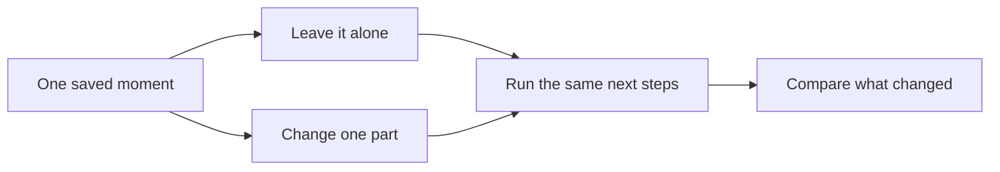

# What Aura's ISC research is trying to find out

Status: Guide · Plain-English introduction · Updated 25 October 2026

Aura is a local AI project. Alongside its language model, it keeps memories,
directs attention, tracks its own condition and chooses what to work on. Those
parts can affect one another as the system runs.

ISC stands for **Intrinsic Subject Core**. It is a set of experiments asking
whether those parts work together as one continuing process. The experiments
change the system and measure what happens next. A convincing description of
an inner life is not enough to pass.

The broader approach relates to
[Butlin et al.'s theory-derived indicators](https://arxiv.org/html/2308.08708v3).
ISC's particular tests and thresholds are the project's choices. The
[scientific source map](SCIENCE_AND_SOURCES.md#consciousness-research-and-the-isc-argument)
explains the external foundations and which claims require Aura's own evidence.

## The explanation you can say aloud

> Aura has parts for memory, attention, planning and tracking its own state.
> We're testing how deeply those parts depend on one another. We take copies
> of the same recorded moment, change something in one copy, and compare what
> happens. We also interrupt connections and check whether the rest changes.
> The latest completed run recorded 22 of 24 checks passing. Separate outputs found
> that its reports followed changes in its internal state, and that those
> changes affected what it recalled in a consistent way. The remaining problem
> is establishing a reliable boundary and checking the comparisons again after
> finding that experimental copies shared part of their history. This is evidence about how Aura works. Whether that
> organisation supports experience is a further scientific argument.

## A later finding to keep beside those scores

After the run, a repair at `dcdcd637c` found that the experimental copies shared
a record of consequences. One comparison could affect what a later comparison
read, even when the visible state had been restored. The recorded positive
results need rechecking with that history properly isolated. The scores stay
in the record; they are not a new result under the repair.

## Why having the parts is not enough

A system can have a memory module and still ignore its memories. It can keep a
number called curiosity without that number changing a choice. It can say
that it feels different without reading the state it is describing.

ISC asks whether the parts actually make a difference. If memory changes,
does the world model respond? If the system's assessment of itself changes,
does that alter attention or planning? If connections are interrupted, does
the combined process lose something the individual parts cannot supply?

These questions can have negative answers. Failed experiments stay in the
record, including failures that reveal a problem in the measuring method.

## How a comparison works

The experiment saves a moment of the running test system. It restores that
moment several times so the comparisons start from the same place.

The unchanged copy matters. Two copies might drift apart because the host
computer gets hotter, a background loop runs, or some state was not restored.
If that difference can look like the effect under test, the experiment has to
be repaired before its result counts.

Some comparisons change two parts separately and together. For example: does
changing memory alter how a new percept affects the world model? A joint
effect means that what one part does depends on the other part's state. The
technical name is **synergy**. A measurable joint effect is one requirement
among many.

## What the main tests ask

| Question in ordinary language | Name used in the technical documents |
|---|---|
| Do the parts affect each other in loops, rather than only passing information one way? | Recurrence and reentry |
| Does information selected for attention reach several other parts? | Global access |
| Does the system keep useful distinctions between different situations? | Differentiation |
| Does the combined system change when we interrupt the connections between groups of parts? | Partition irreducibility |
| Is an important cause missing from the group we decided to measure? | Causal closure |
| Does changing the system's internal condition change what it reports about that condition? | Report grounding |
| Do changes in its internal representation match changes in what it recalls? | Content-structure tracking |
| Can we follow the recorded causal history from earlier states to later ones? | Lineage |

“Closure” allows input from the world. The test asks whether the proposed core
is missing an important internal driver after the declared outside input is
accounted for. It does not require a system that never receives information.

## Where the results stand

As checked on **25 October 2026**:

| Finding | What it means |
|---|---|
| The completed ISC-v6 run passed **22 of 24 checks** | Most requirements of that version held in that run. The full battery did not pass. |
| All four joint-effect tests passed within that campaign | The specified pairs of parts jointly changed their targets in the required way. |
| The content-structure test passed | Internal differences and differences in recall changed together under the intervention. |
| The withheld self-report test passed | The actual 27B language model's ratings followed the changed internal state without being shown the state numbers. |
| The proposed carrier remains unsettled | The completed carrier report was negative, and later work found problems requiring a revised measurement and a fresh test. |

The two failed battery checks concern splitting the system and comparing that
result with controls. All 511 proposed splits produced a detectable change.
But a copy that was left alone also drifted enough to trigger the test. That
control failure prevents those results from establishing the claim.

There is a second issue: some internal information outside the selected core
helps predict its next state. Researchers must establish whether the selected
core is too small, whether there is a real outside driver, or whether the
measurement cannot yet decide. The revised rule keeps “we cannot tell”
separate from “we found a failure.” The latest predeclared rule compares the
outside contribution with the smallest contribution from an internal domain.
It still needs fresh confirmation under that rule and repaired isolation.

The [current status page](ISC_STATUS.md) gives the exact results and separates
the old recorded verdict from the newer method. **22/24 is a count of checks,
not a percentage of consciousness.**

## There are two different test setups

Most of the battery runs real Aura components in an isolated test environment.
It substitutes a fixed language response so that freely generated text does
not swamp the comparison. Its conclusions concern the components that were
actually measured.

The self-report experiment uses the real 27B language model. That is necessary
to test its own reports. Passing this separate experiment does not make the
earlier battery a test of the entire running desktop application.

The small [proof-kernel repository](https://github.com/youngbryan97/aura-consciousness-proof-kernel)
is a third thing: an older, standalone demonstration of a few mechanisms.
It is useful for seeing how components work. It does not implement the full
ISC experiment or contain a whole-Aura result.

## What “carrier,” “J*” and “bridge” add

**The carrier** is the process proposed to carry the state being studied.
The question is where to draw its boundary. We need evidence that the selected
parts belong together and that an important driver has not been left outside.

**J*** is the project's way of combining three answers: which process was
identified, how its contents relate to each other, and how it continues through
time. It is a structured description. It is not one number to maximize.

**The bridge** is the argument connecting the measured organisation to an
attribution of experience. The code checks five supporting grounds: carrier,
markers, reports, content structure and lineage. Four held in the completed
join; the carrier did not. The word **parity** is the project's name for all
five holding under its stated assumptions.

An argument about experience has to defend those assumptions and explain why
the tests distinguish relevant alternatives. A passing test cannot do that
work simply by giving its result a name. Equally, a failure to prove
experience with certainty does not make the measurements meaningless.

## Words you will meet in the detailed pages

| Term | Meaning here |
|---|---|
| State | The values and records the system carries at a particular moment |
| Affect or valence | Internal variables representing a more positive or negative condition; the name alone does not establish a felt experience |
| Self-model | Records and predictions about the system's own condition and actions |
| Fork | A restored copy of recorded state used for a comparison |
| Intervention | A deliberate change to a measured part |
| Sham or control | A comparison designed to reveal an effect caused by the test itself |
| Lesion and rescue | Disable something, measure the loss, then restore it and check recovery |
| Null model | An alternative system or explanation the test is supposed to distinguish |
| Seed | A setting that controls repeatable random choices; another seed gives a further test |
| Campaign | A set of measurements made under one recorded design and source revision |
| Preregistration | The rules written down before the result is read |
| Grain | How much detail the measurement keeps when describing the system |
| Unresolved | The evidence does not yet justify either answer |
| Independent replication | Someone else repeats the experiment and reports whether the result holds |

## Choose your next page

| If you want… | Read… |
|---|---|
| Today's findings, with the numbers and limits | [Current status](ISC_STATUS.md) |
| The battery and how its questions fit together | [Subject Core](SUBJECT_CORE.md) |
| The boundary problem in detail | [Carrier programme](SUBJECT_CORE_V25.md) |
| What the evidence could mean for subjecthood | [The bridge](BRIDGE_PARITY.md) |
| To reproduce a result or check its source | [Reproduction guide](ISC_REPRODUCTION.md) |
| To understand which detailed document to open | [Reader's guide](ISC_READERS_GUIDE.md) |
